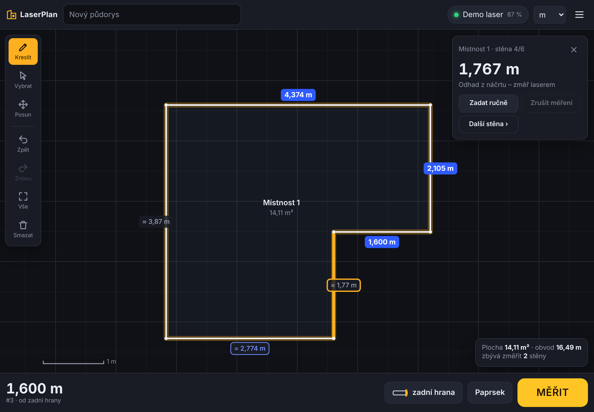
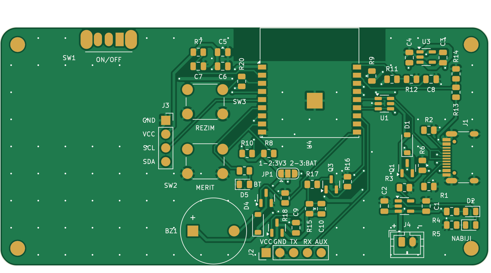
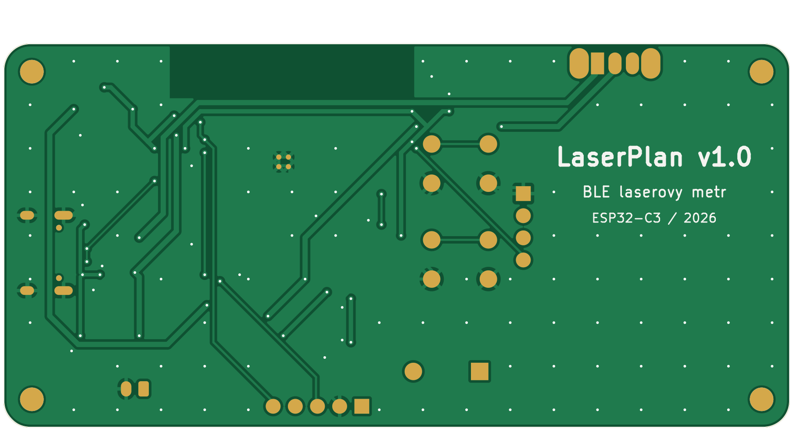
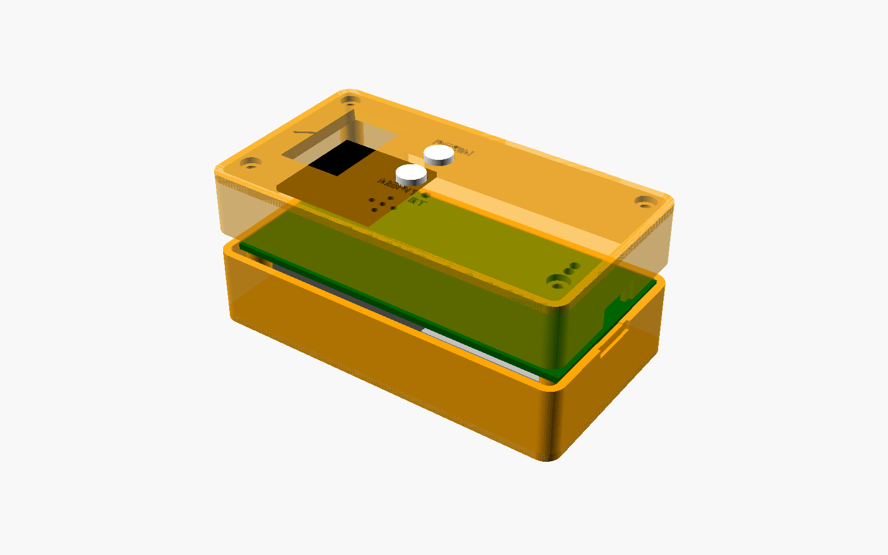
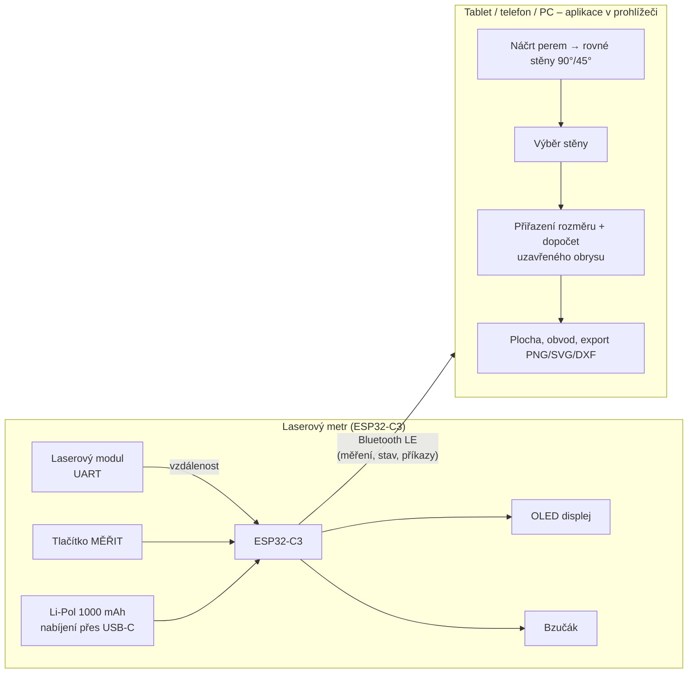

# LaserPlan – chytrý laserový metr s Bluetooth pro náčrt půdorysu

Nakresli prstem nebo perem obrys místnosti na tabletu, ťukni na stěnu, zmáčkni **MĚŘIT** na laseru –
rozměr se sám zapíše do náčrtu, celý půdorys se přepočítá a aplikace vybere další stěnu.
Stěny, které jde dopočítat, měřit nemusíš. Na konci máš plochu, obvod a export do PNG / SVG / DXF.



| Deska plošného spoje (90 × 44 mm) | Spodní strana | Krabička pro 3D tisk |
|---|---|---|
|  |  |  |

## Co je v projektu

| Část | Kde | Stav |
|---|---|---|
| **Elektronika** – schéma, DPS (KiCad 7), Gerbery, kusovník, osazovací soubor | [`hardware/`](hardware/) | DRC bez chyb, 0 nespojených plošek |
| **Firmware** pro ESP32-C3 (Bluetooth LE, ovladače laser modulů, OLED, tlačítka, baterie) | [`firmware/`](firmware/) | přeloženo (PlatformIO) |
| **Aplikace** pro tablet/telefon/PC (náčrt půdorysu + Web Bluetooth), funguje offline | [`app/`](app/) | testy + E2E test v Chromiu prochází |
| **Krabička** pro 3D tisk (OpenSCAD + STL) | [`hardware/krabicka/`](hardware/krabicka/) | STL připravené |
| **Dokumentace** | [`docs/`](docs/) | |

## Jak to funguje



1. **Laserový modul** (průmyslový UART dálkoměr, přesnost ±1–3 mm, dosah 40–100 m) změří vzdálenost.
2. **ESP32-C3** přičte offset podle zvolené reference (zadní / přední hrana krabičky), pípne, ukáže hodnotu
   na OLED a pošle ji přes **Bluetooth LE**.
3. **Aplikace** hodnotu zapíše do vybrané stěny. Náčrt se přeškáluje, „volné“ stěny se dopočítají tak,
   aby se obrys uzavřel, a jednoznačně určené stěny se označí `=` (ty měřit nemusíš).
   Když změříš všechno a obrys nesedí, aplikace ukáže **chybu uzavření** – víš, že je někde chyba.

## Rychlý start

### 1) Vyzkoušej aplikaci hned – bez hardwaru
```bash
cd app && python3 -m http.server 8000
# otevři http://localhost:8000 v Chrome/Edge → Připojit laser → Demo režim
```
Nebo zapni GitHub Pages (Settings → Pages → Source: **GitHub Actions**) – workflow
[`pages.yml`](.github/workflows/pages.yml) aplikaci nasadí na HTTPS adresu a přidá stránku pro nahrání firmwaru.

### 2) Prototyp bez vlastní desky (nejrychlejší cesta k fungujícímu měření)
ESP32-C3 SuperMini + laser modul + nepájivé pole → viz [docs/02-prototyp.md](docs/02-prototyp.md).

### 3) Plná verze s vlastní deskou a krabičkou
1. [Nákupní seznam](docs/01-nakupni-seznam.md) – co koupit a kde
2. [Výroba DPS](docs/03-vyroba-dps.md) – objednání desky (JLCPCB apod.), volitelně i s osazením
3. [Sestavení krok za krokem](docs/04-sestaveni.md) – pájení, oživení, laser, krabička, kalibrace
4. [Firmware](docs/05-firmware.md) – nahrání (i z prohlížeče), ovládání, sériová konzole
5. [Aplikace](docs/06-aplikace.md) – instalace na tablet, práce s náčrtem, export
6. [Bluetooth protokol](docs/07-ble-protokol.md) – pro vlastní aplikace

## Ovládání přístroje

| Tlačítko | Krátký stisk | Dlouhý stisk |
|---|---|---|
| **MĚŘIT** | 1. stisk zapne zaměřovací paprsek, 2. stisk měří | průběžné měření (SCAN) |
| **REŽIM** | reference: zadní ↔ přední hrana | jednotky m ↔ ft-in; 3 s = uspat |

Měřit jde i tlačítkem **MĚŘIT** v aplikaci. Modrá LED bliká = čeká na spojení, svítí = připojeno.
Červená LED = nabíjí se, zelená = nabito.

## Důležité poznámky

- **Hardware je navržený a zkontrolovaný softwarově, ale zatím nebyl fyzicky postaven a odzkoušen.**
  Deska prošla kontrolou DRC a netlist schématu je ověřený proti desce, firmware se přeloží a aplikace
  je otestovaná – první kus ale ber jako prototyp. Postup oživení s kontrolami je v [sestavení](docs/04-sestaveni.md).
- **Laserové moduly** se liší protokolem. Firmware umí binární protokol JRT a textový „D/O/C“
  protokol (automatická detekce) + simulaci. Před nákupem si ověř, že modul má **UART s logikou 3,3 V**.
- **iPad/iPhone**: Safari neumí Web Bluetooth – použij prohlížeč **Bluefy** (zdarma v App Store).
  Android, Windows, macOS, Linux a ChromeOS fungují v Chrome/Edge.
- **Li-Pol baterie**: zkontroluj polaritu konektoru (u čínských článků bývá opačně) – viz sestavení.

## Struktura repozitáře

```
app/                 webová aplikace (PWA, bez závislostí) + testy
firmware/            PlatformIO projekt pro ESP32-C3
hardware/
  generator/         Python skripty: zapojení → schéma → DPS → autorouter → výrobní data
  kicad/             KiCad 7 projekt (schéma, deska, knihovna symbolů)
  vyroba/            Gerbery (zip), BOM, CPL, schéma PDF, 3D model STEP
  krabicka/          OpenSCAD model + STL
docs/                návody a obrázky
```
