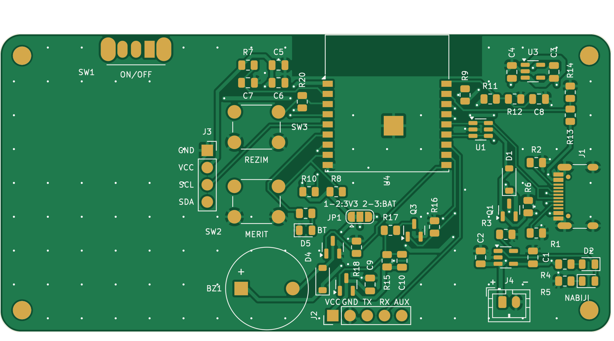
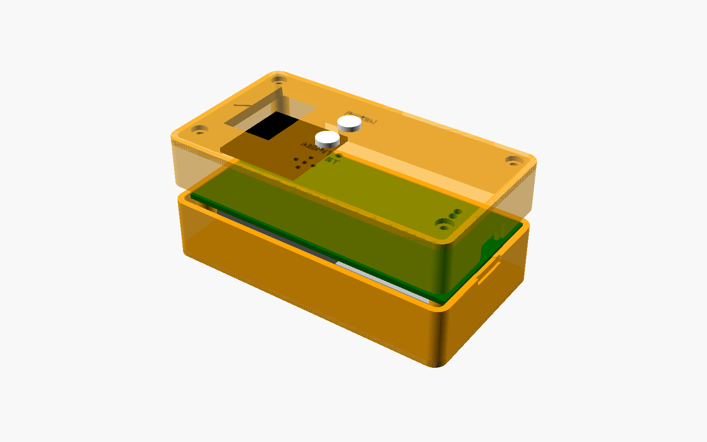

# 4. Sestavení krok za krokem

Měj po ruce vytištěné [schéma](../hardware/vyroba/schema.pdf) a [kusovník](../hardware/vyroba/bom.md).
Rozmístění součástek je vidět na sítotisku desky:

## 4.1 Pájení (od nejnižších a nejtěžších součástek)

> Tip: na každou SMD plošku nejdřív dej tavidlo. U pouzder 0805 nacínuj jednu plošku, přichyť součástku
> pinzetou, pak zapájej druhou stranu a nakonec doladíš první.

1. **USB-C konektor J1** – nejtěžší část (rozteč 0,5 mm).
   - Horkým vzduchem: pasta na plošky, konektor zasunout kolíky do otvorů, ohřát.
   - Mikropájkou: zapájej 4 velké vývody pláště, pak nanes hodně tavidla a „protáhni“ cín přes řadu
     plošek; přebytečné můstky odsaj knotem. **Pod lupou zkontroluj, že mezi ploškami nejsou zkraty.**
2. **U1** USBLC6 (ESD ochrana), **U2** MCP73831 (nabíječka), **U3** AP2112K (stabilizátor 3,3 V) –
   pozor na orientaci (tečka / zkosení = pin 1, na sítotisku je značka).
3. **Q1, Q2** (AO3401A, P-MOSFET) a **Q3, Q4** (AO3400A, N-MOSFET) – nezaměň je!
4. **D1** B5819W a **D4** 1N4148W – proužek = katoda (shoduje se s čárou na sítotisku).
5. Rezistory a kondenzátory 0805 podle kusovníku.
6. **LED**: D2 červená, D3 zelená, D5 modrá – katoda (zelená tečka/čárka na spodku LED) k označené straně.
7. **U4 ESP32-C3-WROOM-02** – zarovnej modul na plošky, zapájej dva protilehlé rohy, zkontroluj polohu
   a pak všechny boční plošky. Zemnicí plocha pod modulem má 4 prokovy – **ze spodní strany** do nich
   nahřej cín, ten zateče a spojí ji (není to nutné pro funkci, ale zlepší zem a chlazení).
8. **Propojka JP1**: z výroby je **spojena 1–2** (laser napájen z 3,3 V). Neměň, pokud laser nepotřebuje více.
9. **THT součástky**: tlačítka SW2 (MĚŘIT) a SW3 (REŽIM), vypínač SW1 (páčka přesahuje horní hranu desky),
   bzučák BZ1 (**+ podle sítotisku**), dutinková lišta J3 pro OLED, kolíková lišta J2 pro laser,
   svislý konektor baterie J4.

## 4.2 Kontrola před prvním zapnutím (bez baterie!)

Multimetrem v režimu odporu/prozvánění změř – **nesmí být zkrat** (hodnota by měla být > 1 kΩ):

| Mezi | Kde měřit |
|---|---|
| VBUS – GND | kladný vývod C1 a GND |
| VBAT – GND | pin + konektoru J4 a pin − |
| 3V3 – GND | J3 pin VCC a GND |

## 4.3 První zapnutí přes USB

1. Vypínač na **ON**, připoj USB-C. Má se rozsvítit **červená** LED (nabíjení; bez baterie může slabě
   svítit i zelená – to je normální).
2. Změř napětí na J3 VCC–GND: **3,3 V** (±0,1 V).
3. Počítač by měl najít zařízení **USB JTAG/serial debug unit** (ESP32-C3 má USB přímo v čipu).
   Pokud ne: drž **MĚŘIT** (= BOOT), přepni vypínač OFF→ON, pusť.

## 4.4 Nahrání firmwaru

Viz [05-firmware.md](05-firmware.md). Nejjednodušeji přes stránku **flash.html** v aplikaci
(Chrome/Edge na počítači), jinak `pio run -e laserplan -t upload`.

Po nahrání: bzučák zahraje tři tóny, modrá LED bliká (čeká na Bluetooth). V sériové konzoli napiš `info`.

## 4.5 Baterie – POZOR NA POLARITU

Konektor **J4: levý pin = + (VBAT), pravý pin = − (GND)** – je to vyznačeno na sítotisku `+` / `−`.
Čínské Li-Pol články s konektorem JST-PH mají **často prohozenou polaritu**! Před zasunutím změř
multimetrem napětí na konektoru baterie. Pokud je obráceně: jehlou nadzvedni západky v konektoru
na kabelu, kontakty vytáhni a prohoď.

Po připojení baterie a USB svítí červená LED, po nabití zelená. Bez USB se přístroj zapíná vypínačem.

## 4.6 Připojení laserového modulu

Konektor **J2** (na desce popsáno):

| J2 pin | Signál | Kam na modulu |
|---|---|---|
| 1 | VCC (spínané) | napájení modulu |
| 2 | GND | zem |
| 3 | TX | **TX modulu** (data z modulu → ESP RX) |
| 4 | RX | **RX modulu** (ESP TX → modul) |
| 5 | AUX | PWR/EN modulu, má-li ho (jinak nezapojuj) |

- Napájení modulu je spínané tranzistorem Q2 – firmware ho zapne jen při měření (šetří baterii).
- Pokud modul potřebuje **3,6–5 V**: přeřízni spoj propojky JP1 mezi ploškami 1–2 a spoj cínem 2–3
  (laser je pak napájen přímo z baterie/USB). **Logika UART musí i tak zůstat 3,3 V!**
- V konzoli: `raw 1` a `m` – uvidíš komunikaci. Firmware zkouší automaticky protokol JRT
  (115200 / 19200 / 9600 Bd) a textový protokol. Když modul nenajde, prohoď TX/RX.

## 4.7 OLED displej

Zasuň OLED kolíky do dutinkové lišty J3 **displejem nahoru a záhlavím směrem dozadu (k USB)** –
displej pak leží nad levou částí desky. **Ověř pořadí pinů na svém modulu: GND, VCC, SCL, SDA**
(některé moduly mají VCC a GND prohozené – takový by se zničil). Pokud máš text vzhůru nohama,
změň `OLED_ROTATION` v `firmware/include/config.h` na `0`.

## 4.8 Krabička

STL soubory jsou v [`hardware/krabicka/`](../hardware/krabicka/) (zdroj `krabicka.scad`, parametry jako
rozměry laser modulu a baterie jsou na začátku souboru – **změř svůj modul a uprav je**).

- `spodek.stl` – tiskni dnem dolů, `vicko.stl` – už je otočené vrchem dolů, `hmatnik.stl` – 2 ks.
- PETG nebo PLA, vrstva 0,2 mm, 3 perimetry, 20 % výplň, bez podpor.

Postup:
1. Laser modul přilep oboustrannou páskou na dno **čelem až k přední stěně**, optikou do okénka.
2. Baterii přilep do zadní části (mezi rohové zarážky).
3. Kabely od laseru a baterie veď kanálem podél spodní hrany (strana s J2/J4) nahoru ke konektorům.
4. Desku polož na 4 sloupky (páčka vypínače vyleze otvorem v boční stěně, USB-C k zadní stěně).
5. Hmatníky vlož zespodu do otvorů ve víku (límcem dovnitř), víko nasaď a stáhni **4× M2.5 × 30**.

## 4.9 Kalibrace

Firmware předpokládá rozměry krabičky z `krabicka.scad` (zadní hrana 93 mm za nulou modulu,
přední hrana −2 mm). Přesně to doladíš v aplikaci:

1. Připoj laser v aplikaci, nastav referenci **zadní hrana** (tlačítko vedle MĚŘIT).
2. Opři přístroj zadní hranou o zeď a změř vzdálenost k protější zdi, kterou znáš (svinovací metr).
3. V dialogu laseru zadej skutečnou hodnotu a klikni **Kalibrovat podle posledního měření**.
4. Totéž můžeš udělat pro přední hranu. Korekce se uloží do přístroje.
