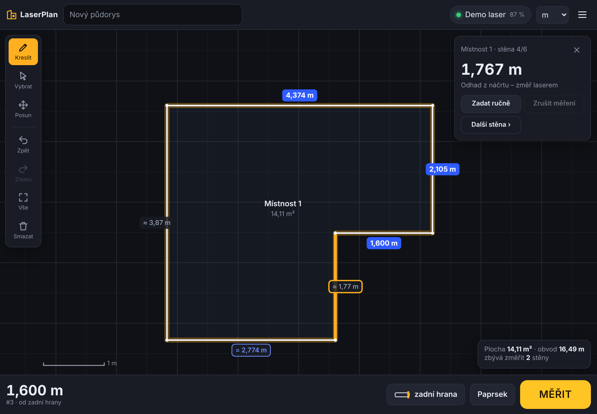

# 6. Aplikace LaserPlan

Webová aplikace ve složce [`app/`](../app/) – čisté HTML/CSS/JavaScript bez knihoven a bez buildu.
Funguje na tabletu, telefonu i počítači, umí se „nainstalovat“ na plochu (PWA) a funguje **offline**.



## Kde ji spustit

Web Bluetooth funguje jen na **HTTPS** (nebo `localhost`). Možnosti:

1. **GitHub Pages (doporučeno)** – v repozitáři *Settings → Pages → Build and deployment →
   Source: GitHub Actions*. Po každém pushi do `main` workflow
   [`pages.yml`](../.github/workflows/pages.yml) otestuje aplikaci, přeloží firmware a nasadí obojí na
   `https://<účet>.github.io/<repozitář>/`. Tuto adresu otevři na tabletu.
2. **Lokálně** na počítači: `cd app && python3 -m http.server 8000` → `http://localhost:8000`.
3. Jakýkoli jiný HTTPS hosting (Netlify, Cloudflare Pages…) – stačí nahrát obsah složky `app/`.

### Podporované prohlížeče

| Zařízení | Prohlížeč |
|---|---|
| Android tablet / telefon | **Chrome** ✔ |
| Windows, macOS, Linux, ChromeOS | **Chrome** nebo **Edge** ✔ |
| iPad / iPhone | Safari Web Bluetooth neumí → nainstaluj **Bluefy – Web BLE Browser** (zdarma) a stránku otevři v něm ✔ |
| Firefox | Web Bluetooth nepodporuje (aplikace funguje jen v demo režimu) |

Na tabletu dej v prohlížeči **Přidat na plochu** – aplikace pak běží v celé obrazovce jako normální appka.

## Práce s aplikací

1. **Připoj laser** – ťukni nahoře na „Připojit laser“ → *Připojit přes Bluetooth* → vyber
   `LaserPlan-XXXX`. (Bez hardwaru zkus **Demo režim**.)
2. **Nakresli místnost** jedním tahem (nástroj *Kreslit*). Aplikace:
   - zjednoduší křivku na rovné úseky,
   - přichytí směry na **90°** (a 45°, pokud je povoleno v menu),
   - když skončíš blízko začátku, **uzavře obrys**,
   - z měřítka zobrazení odhadne délky (`≈ 3,45 m` šedě).
3. **Ťukni na stěnu** (oranžová) a **zmáčkni MĚŘIT** na přístroji nebo v aplikaci.
   - Rozměr se zapíše (modrý štítek), celý náčrt se přeškáluje podle prvního měření.
   - Aplikace sama vybere **další stěnu** (lze vypnout v menu).
   - Stěny, které už jdou dopočítat z uzavření obrysu, mají rámeček a `=` – ty měřit nemusíš.
4. Po změření všech potřebných stěn vpravo dole uvidíš **plochu a obvod**. Pokud změříš úplně všechny
   stěny a obrys nesedí víc než o 10 mm (nebo 0,2 % obvodu), aplikace upozorní na **chybu uzavření**.
5. Další místnosti kresli vedle, nástrojem **Posun** je přesuneš. Dvojklik do místnosti = přejmenovat.

### Tipy

- Měření bez vybrané stěny se uloží jako „čekající“ – ťukni pak na stěnu, kam patří.
- **Dvojklik / dvojťuk na stěnu** = ruční zadání délky (`3,452`, `345 cm`, `3452 mm`, `11' 4 3/8"`).
- Dva prsty = posun a zoom; kolečko myši = zoom; pravé tlačítko = posun.
- V menu zapni **Kreslit jen perem**, pokud kreslíš Apple Pencilem/stylusem a prstem chceš jen posouvat.
- Klávesy: `M`/mezerník měřit, `D` kreslit, `V` vybrat, `P` posun, `F` zobrazit vše, `Tab` další stěna,
  `Enter` ruční zadání, `Ctrl+Z` / `Ctrl+Y` zpět / znovu, `Delete` smazat místnost.

## Ukládání a export

- Rozpracovaný půdorys se ukládá automaticky (v prohlížeči). *Menu → Uložit do projektů* vytvoří
  pojmenovanou kopii; projekty jdou otevírat a mazat.
- Export: **PNG** (obrázek), **SVG** (vektor v měřítku 1 jednotka = 1 mm), **DXF** (pro CAD –
  vrstva STENY a KOTY), **JSON** (záloha / import).

## Testy

```bash
node --test app/tests/*.test.mjs        # geometrie, rozpoznání tahu, jednotky
cd app && python3 -m http.server 8765 &
node tests/e2e.mjs                      # nakreslí L-místnost, změří ji demo laserem (Playwright)
```
