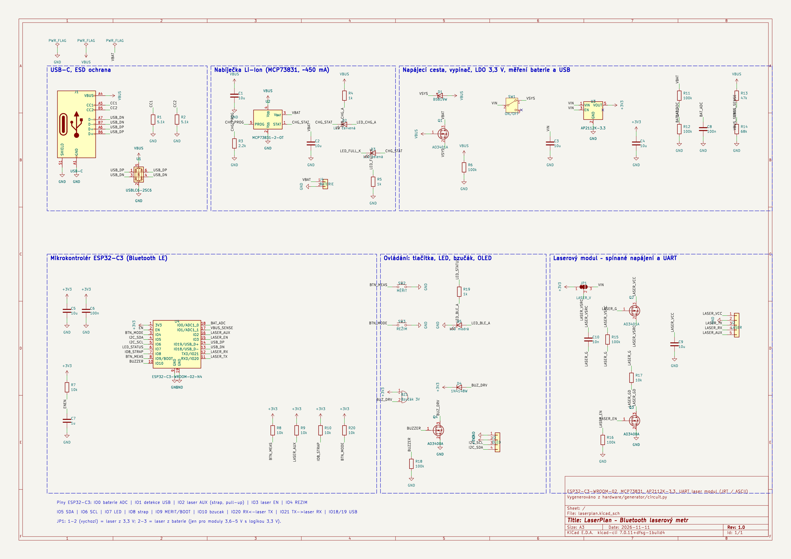

# Hardware LaserPlan



## Zapojení v kostce

| Blok | Součástky | Poznámka |
|---|---|---|
| USB-C | J1, R1/R2 (5,1 kΩ CC), U1 USBLC6-2SC6 | nabíjení + programování (nativní USB ESP32-C3), ESD ochrana |
| Nabíječka | U2 MCP73831 (≈ 450 mA, R3 2,2 kΩ), D2/D3 LED | červená = nabíjí, zelená = nabito |
| Napájecí cesta | D1 B5819W, Q1 AO3401A, R6 | z USB napájí systém přes diodu, baterie se automaticky odpojí (load sharing) |
| Vypínač, LDO | SW1, U3 AP2112K-3.3 (600 mA) | vypínač odpojí vše kromě nabíjení |
| Měření | R11/R12 (baterie → IO0), R13/R14 (USB → IO1) | |
| MCU | U4 ESP32-C3-WROOM-02 | anténa na hraně desky nad oblastí bez mědi |
| Laser | J2, Q2 AO3401A + Q3 AO3400A, JP1 | spínané napájení modulu s měkkým startem (C10), volba 3,3 V / baterie |
| Ovládání | SW2 MĚŘIT (= BOOT), SW3 REŽIM, D5 modrá LED, BZ1 + Q4 | |
| Displej | J3 – OLED SSD1306 I2C | |

### Piny ESP32-C3

| GPIO | Funkce | GPIO | Funkce |
|---|---|---|---|
| IO0 | ADC baterie | IO6 | I2C SCL |
| IO1 | detekce USB | IO7 | modrá LED |
| IO2 | laser AUX (strap, pull-up) | IO8 | strap (pull-up) |
| IO3 | laser EN | IO9 | MĚŘIT / BOOT |
| IO4 | REŽIM (probouzí ze spánku) | IO10 | bzučák |
| IO5 | I2C SDA | IO20 / IO21 | UART RX ← laser TX / TX → laser RX |
| IO18 / IO19 | USB D− / D+ | | |

## Jak návrh vznikl a jak ho upravit

Celý hardware je **generovaný z kódu** – jediným zdrojem pravdy je
[`generator/circuit.py`](generator/circuit.py) (součástky, hodnoty, pouzdra, sítě).

```bash
cd hardware/generator
./build_all.sh
```

| Skript | Co dělá |
|---|---|
| `gen_schematic.py` | schéma KiCad (`kicad/laserplan.kicad_sch`) – bloky, jmenovky sítí, vlastní symbol ESP32-C3-WROOM-02 |
| `gen_pcb.py place` | deska: footprinty z knihoven KiCadu, rozmístění (`PLACEMENT`), obrys, sítotisk |
| `router.py` | vlastní dvouvrstvý autorouter (A* na mřížce 0,25 mm s přesnou kontrolou izolací, rip-up & reroute, pevně navržené vyvedení USB-C) |
| `gen_pcb.py finish` | rozlitá zem na obou vrstvách, prošívací prokovy, DRC report |
| `export.py` | Gerbery, vrtání, BOM, CPL, PDF schéma, náhledy, STEP |

Potřebuješ **KiCad 7** (s Python modulem `pcbnew`), Python 3 s `numpy` a `cairosvg`.

Kontroly:
- `kicad/drc_report.txt` – **0 chyb, 0 nespojených plošek**. Jediná zbylá upozornění jsou
  `lib_footprint_issues` – vznikají jen proto, že v generovacím prostředí nebyla nastavená globální
  tabulka knihoven footprintů; v normálně nainstalovaném KiCadu zmizí.
- Netlist exportovaný ze schématu (`kicad-cli sch export netlist`) se shoduje s `circuit.py` (34 sítí).

> Pokud budeš desku dál upravovat ručně v KiCadu, už ji negeneruj skripty znovu (přepsaly by tvé změny).
> Schéma a deska jsou propojené (stejná UUID), takže *Aktualizovat DPS ze schématu* funguje.

## Rozměry

- DPS 90 × 44 mm, otvory M2.5 ve vzdálenosti 3,2 mm od rohů
- výška součástek nad DPS: tlačítka 13 mm, OLED na dutinkové liště ≈ 13,7 mm, bzučák 9,5 mm
- pod DPS jen vývody THT součástek (≈ 2 mm)
- krabička: 95 × 52 × 36 mm ([`krabicka/krabicka.scad`](krabicka/krabicka.scad))
